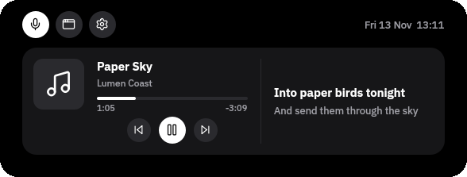
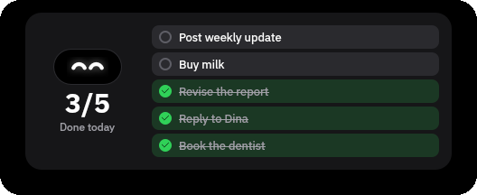
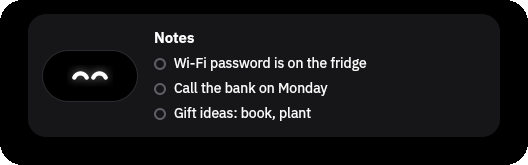
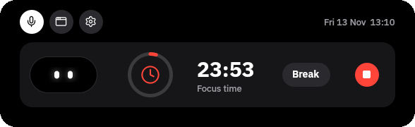
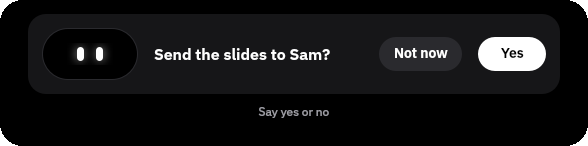
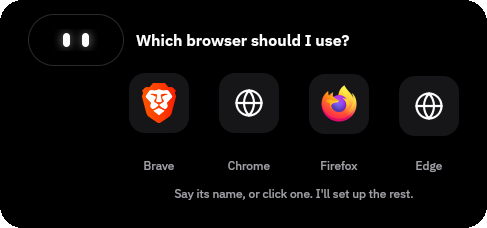
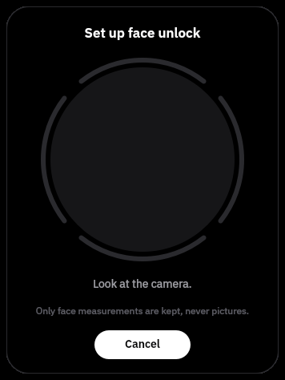
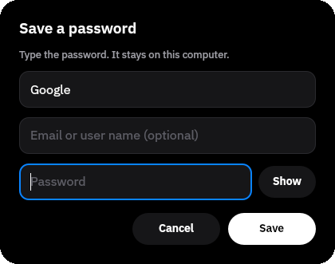
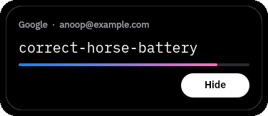
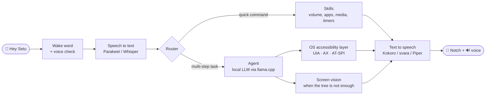

<div align="center">

# Setu (सेतु)

### **S**peech-**E**nabled **T**ool **U**nification

*सेतु means "bridge" in Sanskrit and Hindi. Setu is the bridge between your voice and your computer.*

<br>


<br><br>

**An open-source, local-first AI voice assistant for Linux, Windows and macOS.**<br>
Say **"Hey Setu"**, then say what you want done.

<br>


<br>


[**What it does**](#what-can-i-say) ·
[**Screenshots**](#the-notch) ·
[**How it works**](#how-it-works) ·
[**Privacy**](#privacy) ·
[**Build**](#build-it-yourself) ·
[**FAQ**](#faq)

</div>

---

## Why Setu?

Most voice assistants send your voice to the cloud and can only do what their makers built in. Setu works differently:

| | |
| --- | --- |
| 🏠 **Runs on your computer** | Speech recognition, the language model and the voice all run on your own machine by default. Audio is never stored. |
| 🖱️ **Controls any app** | Setu goes through the accessibility layer built into your OS (UI Automation, AX, AT-SPI), so it can press buttons, read pages and fill in fields in almost any app. No browser extension needed. |
| 🇮🇳 **Speaks with an Indian voice** | A natural Indian voice from Kokoro, or **svara** with **19 Indian languages** if you have a graphics card. |
| 🎤 **Answers only you** | During setup you read a short paragraph three times, and from then on Setu responds only to your voice. |
| 🛑 **Asks before acting** | Before buying, sending or deleting anything, Setu asks first. |
| 🧩 **Use online models if you want** | You can switch the brain or the voice to OpenAI, Anthropic, Google Gemini, ElevenLabs or any OpenAI-compatible API. Your key is kept in the system keychain. |

---

## What can I say?

> [!TIP]
> Click a section to expand it. You can chain several steps in one request:<br>
> *"Open a new window in Brave and search for Mr Beast, after that put two Brave windows side by side."*

<details>
<summary><b>Browser</b>: tabs, links, logins, YouTube, Netflix</summary>
<br>

- "In Brave, open YouTube and play Arijit Singh"
- "Watch Stranger Things on Netflix"
- "Log in to my Google account"
- "Open the third link in a new tab"
- "Save the second image" · "Copy the link of the first result"
- "Close the YouTube tab" · "Go to tab 3" · "Pin this tab"
- "Bookmark this page" · "Find biography on this page"
- "Open an incognito window" · "Number the images"

Setu works inside **your own browser and profile**, so there is nothing to install.
</details>

<details>
<summary><b>Media</b>: knows what is playing, everywhere</summary>
<br>

- "Pause" · "Resume" · "Next song" · "What's playing?"
- "Pause Spotify" · "Mute the YouTube tab"

If YouTube and Spotify are both playing and you say "pause", Setu asks:
> *"There are two media playing, one is YouTube and the other is Spotify. Which one should I pause?"*
</details>

<details>
<summary><b>Coding</b>: VS Code, JetBrains, Xcode, Visual Studio and more</summary>
<br>

Works with VS Code, Visual Studio, JetBrains IDEs (IntelliJ IDEA, PyCharm, CLion, WebStorm, GoLand, Rider, Android Studio), Xcode, Eclipse, Qt Creator, Sublime Text, Notepad++ and Zed.

- "Create a new Python project called weather app"
- "Create a file called tut1.cpp" · "Open main.cpp in PyCharm"
- "Start coding" puts exactly what you say at the cursor
- "Write a function that …" · "Add a comment saying …"
- **"Am I wrong somewhere?"** names the first mistake and moves the cursor to it
- **"Run my code"** runs it, and if it fails, Setu tells you why
- "Format the document" · "Go to line 20" · "Commit my changes" · "Push my code"
</details>

<details>
<summary><b>Windows and apps</b>: snap, switch, arrange</summary>
<br>

- "Open Spotify" · "Close Chrome"
- "Snap this window left" · "Maximise" · "Show the desktop"
- "Switch to Spotify" · "Put Chrome and VS Code side by side"
</details>

<details>
<summary><b>System</b>: volume, brightness, Wi-Fi, files, downloads</summary>
<br>

- "Turn the volume down" · "Set brightness to 40" · "Connect to Wi-Fi"
- "Open D drive" · "Open my pen drive" · "Find the file resume"
- "Open my last download" · "How much space is left?"
- **"Download VLC"** installs it the right way for your OS: Microsoft Store or winget on Windows, App Store or Homebrew on Mac, and your distro's packages, Flatpak or Snap on Linux. Installers are checksum-verified.
</details>

<details>
<summary><b>Productivity</b>: timers, focus, reminders, notes, to-dos</summary>
<br>

- "Set a timer for 10 minutes" · "Start focus"
- "Remind me to call Mom at six"
- "Take a note …" · "Add buy milk to my to-do list"

All of these stay visible in the notch.
</details>

<details>
<summary><b>Messages</b>: WhatsApp and more</summary>
<br>

- "Open the chat with Binod on WhatsApp"
- "Send a message to Binod saying I'll be late" *(Setu asks before sending)*
</details>

<details>
<summary><b>Passwords and face unlock</b></summary>
<br>

- "Set up face unlock" · "Show my Google password"
- "Type my password" (into a password box or a `sudo` prompt) · "Sign in to Google"

Passwords are kept in an **encrypted vault** whose key is in the system keychain. They are never spoken aloud, logged, shown in the chat or sent to a model. A saved password is only ever filled in on its own website. On Linux, waking the lock screen while you sit in front of it unlocks the PC.
</details>

<details>
<summary><b>Chat and memory</b></summary>
<br>

- Ask anything. Typed questions get full answers that build on the conversation.
- "Remember that my sister's name is Priya"
- "What do you know about me?" · "Forget that …"

Voice and typed requests share the same chat history.
</details>

---

## The notch

Setu sits in a small black notch at the top of your screen. The sound wave is **blue while it listens** and **pink while it talks**.

<table>
<tr>
<td align="center"><br><sub><b>Listening</b>: blue wave</sub></td>
<td align="center"><br><sub><b>Speaking</b>: pink wave</sub></td>
</tr>
<tr>
<td align="center"><br><sub><b>Working on it</b></sub></td>
<td align="center"><br><sub><b>Doing it</b></sub></td>
</tr>
</table>

<details open>
<summary><b>Music, with artwork and synced lyrics</b></summary>
<br>
<div align="center"></div>
</details>

<details>
<summary><b>To-dos, notes, focus and timers</b></summary>
<br>
<table>
<tr>
<td align="center"></td>
<td align="center"></td>
</tr>
<tr>
<td align="center"></td>
<td align="center"></td>
</tr>
</table>
</details>

<details>
<summary><b>Questions and confirmations</b></summary>
<br>
<div align="center">
<br><br>

</div>
</details>

<details>
<summary><b>Face unlock and the password vault</b></summary>
<br>
<table>
<tr>
<td align="center"><br><sub>Only face measurements are kept, never pictures</sub></td>
<td align="center"><br><br></td>
</tr>
</table>
</details>

---

## How it works



Setu is made of a few small processes:

| Part | Language | What it does |
| --- | --- | --- |
| `setu-daemon` | 🦀 Rust | Handles the microphone, wake word, sessions, routing, tools, storage, downloads and the IPC socket. |
| `setu-engine` | 🦀 Rust | Sandboxed child processes for speech recognition, the LLM, speech output and screen reading. They start when needed and are unloaded when idle. |
| `setu-shell` | 🎨 Qt 6 / QML | Always running: the tray icon, the notch, the numbered badges and the camera preview. |
| `setu-ui` | 🎨 Qt 6 / QML | Opens on demand for the chat window, settings and the setup wizard. |
| `setu-system` | 🦀 Rust | Optional, installed only if you agree. A small root-side helper for a fixed list of admin jobs, and face sign-in on Linux. |

<details>
<summary><b>More technical details</b></summary>
<br>

- **Native control.** Setu uses UI Automation on Windows (plus the Java Access Bridge for JetBrains IDEs), AXUIElement on macOS and AT-SPI on Linux, all written in Rust (`daemon/core/src/os/`). The coding layer is `daemon/core/src/ide.rs`.
- **IPC.** The UI and the daemon talk over a Unix socket (a named pipe on Windows) using length-prefixed JSON.
- **GPU.** The language model runs through Vulkan (Metal on Mac) when a graphics card is available.
- **Keyboard on Linux.** Setu uses a kernel `uinput` virtual keyboard, which works on X11 and every Wayland desktop. The fallbacks are `xdotool`, `wtype` and `ydotool`.
</details>

---

## Models

A built-in library lets you choose models that suit your computer. Setup picks sensible defaults for you.

| Job | Options |
| --- | --- |
| 🧠 **Brain (LLM)** | Qwen, Llama, Gemma, Phi, SmolLM and Granite, in several sizes and quantizations |
| 👂 **Hearing (STT)** | Parakeet, Whisper |
| 🗣️ **Voice (TTS)** | Kokoro, svara (19 Indian languages, needs a GPU), Piper |
| 👁️ **Vision** | A small Qwen model with its vision projector, through llama.cpp's `libmtmd` |
| ☁️ **Optional cloud** | OpenAI, Anthropic, Google Gemini, ElevenLabs, any OpenAI-compatible API |

---

## Privacy

> [!IMPORTANT]
> - 🎤 **Nothing is processed before the wake phrase**, and audio is never stored.
> - 🏠 By default, speech recognition, the LLM and the voice all run **on your computer**.
> - 🔑 API keys and the password vault key are kept in your **system keychain**.
> - 📷 Face unlock keeps **only face measurements, never pictures**.
> - 🛂 Permissions are asked **only when they are needed**, not all at once at the start.

---

## First run

1. **Install and start Setu.** A short setup opens.
2. **Setu chooses models** for your computer, then downloads and loads them.
3. **Setu talks you through setup in its own voice.** You can answer naturally, for example *"make it sound like a woman"* or *"go back"*.
4. **Read a short paragraph three times** so Setu learns your voice.
5. **Choose your browser** by saying its name.
6. That's it. Setu stays in the background until you say **"Hey Setu"**.

> [!NOTE]
> To open the chat window, say *"Hey Setu, open yourself."*

---

## Build it yourself

<details>
<summary><b>Linux: one command</b></summary>
<br>

```bash
packaging/linux/build.sh            # AppImage, .deb and .rpm, whichever tools are installed
packaging/linux/build.sh rpm        # one format
```

The packages, `SHA256SUMS` and an SPDX SBOM are written to `dist/`. Set `SETU_GPG_KEY` to sign the checksums.

**Requirements:** Rust (stable), CMake 3.24+, Ninja, a C++17 compiler, Vulkan headers and loader (plus `glslc` for the GPU backend), Qt 6.8+ (Core, Gui, Qml, Quick, QuickControls2, Network, Svg, DBus, LinguistTools, Qt Quick Dialogs, Qt Labs Platform), libclang, libpulse, libsecret headers, xcb-shape, Python 3, and `espeak-ng` at run time. LayerShellQt is optional (for KDE and wlroots overlays).
</details>

<details>
<summary><b>Developer build</b></summary>
<br>

```bash
git clone --depth 1 https://github.com/ggml-org/llama.cpp.git llama.cpp
scripts/fetch-deps.sh        # sherpa-onnx and small bundled models, checksum-verified
scripts/build-llama.sh       # llama.cpp shared libraries (adds Vulkan when glslc is found)
(cd daemon && cargo build --release)
cmake -S . -B build/qt -G Ninja -DCMAKE_BUILD_TYPE=RelWithDebInfo
cmake --build build/qt
```

Run it from the build tree:

```bash
daemon/target/release/setu-daemon --foreground &
build/qt/setu-shell &                  # tray and notch; opens the setup until it is finished
build/qt/setu-ui --page home           # or say "Hey Setu, open yourself"
```

`SETU_DATA_DIR` and `SETU_RUNTIME_DIR` point everything at a separate data and socket folder, which keeps experiments away from your real settings.
</details>

<details>
<summary><b>macOS</b></summary>
<br>

```bash
./build-macos.sh             # installs cmake, ninja, Qt and Rust if missing, then builds
packaging/macos/build.sh     # writes a .dmg to dist/
```

The script builds a universal app when Qt is universal. With `SETU_SIGN_ID` and `SETU_NOTARY_PROFILE` set, it signs, notarizes and staples the app. Without them it signs ad hoc.
</details>

<details>
<summary><b>Windows</b></summary>
<br>

**Cross-compiled from Linux:**
```bash
packaging/windows/cross-build.sh     # writes dist/Setu-<version>-x64-setup.exe and a portable zip
```

**On Windows (PowerShell):**
```powershell
packaging\windows\build.ps1          # x64, or -Arch arm64
```
</details>

<details>
<summary><b>Project layout</b></summary>
<br>

```
daemon/          Rust workspace: protocol, audio, engine, the daemon, skills, agent, native control
src/             Qt/C++: daemon client, secret store, settings, the shell and window entry points
qml/             the notch, the chat window, settings and the setup wizard
assets/          icons, fonts, animations and licence texts
i18n/            translations
scripts/         dependency fetch, licence list, SBOM, contrast and accessibility checks
packaging/       Linux, macOS and Windows installers
```
</details>

---

## FAQ

<details>
<summary><b>Do I need an internet connection?</b></summary>
<br>
Only to download models the first time, and for things that need the web anyway (websites, downloads). Speech recognition, the brain and the voice run on your computer by default.
</details>

<details>
<summary><b>Do I need a graphics card?</b></summary>
<br>
No. Setu runs on the CPU. A GPU (Vulkan, or Metal on Mac) makes the language model faster and enables the svara voice with 19 Indian languages.
</details>

<details>
<summary><b>Does it need a browser extension?</b></summary>
<br>
No. Setu controls your browser through the OS accessibility layer, using your own profile.
</details>

<details>
<summary><b>Will it react to other people or the TV?</b></summary>
<br>
During setup, Setu learns your voice and then responds only to you.
</details>

<details>
<summary><b>Can it do something I didn't ask for?</b></summary>
<br>
Before buying, sending or deleting anything, Setu stops and asks you first.
</details>

---

## License

A license for Setu's own code has not been chosen yet. Until one is, all rights are reserved by the authors. Third-party components keep their own licenses, which are listed in `assets/licenses/`.

<div align="center">
<br>

**If Setu made you smile, please give it a ⭐. It really helps!**

<sub>Made with ❤️ in India</sub>

</div>
